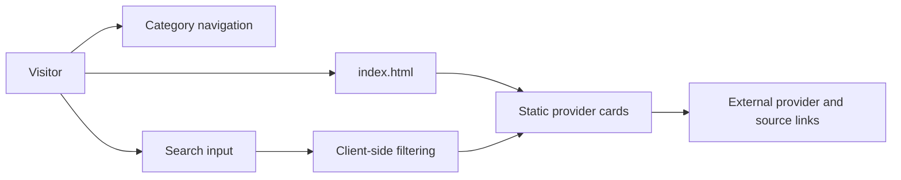

# Free AI API Directory

A searchable, single-page directory of free and community-accessible AI APIs. The page groups providers by capability and records practical constraints such as card requirements, temporary-email support, free-tier limits, and whether a service is suitable only for experimentation.

## Project overview

The project is a static reference interface rather than an API client or backend service. Its goal is to make a large, manually curated provider list easier to browse than a plain document. Visitors can jump to categories, expand sections, search provider cards, and follow the source links maintained in the page.

## Implemented features

- Categorized listings for chat/LLM, image, video, speech, music, search, code generation, embeddings, vision, moderation, translation, GPU compute, proxies, and related services.
- Visual badges for payment-card requirements, temporary-email compatibility, and temperature or access notes.
- Expandable category panels with the first category opened by default.
- Client-side search that filters matching cards and automatically opens matching categories.
- External links to provider documentation, source lists, and community dashboards.
- Responsive layout built with CSS and semantic HTML; no server or database is required.

## Technology stack

| Layer | Implementation |
|---|---|
| Markup | A single `index.html` document |
| Styling | Embedded CSS custom properties, responsive layout, cards, badges, and panels |
| Behaviour | Vanilla JavaScript for section toggling and in-memory search filtering |
| Data | Static HTML content maintained in the page |

No framework, package manager, build step, API server, or persistent storage is present.

## Architecture and workflow



On page load, the first category is opened. Clicking a category toggles its panel. Entering text in the search field compares the query with each card's text and `data-search` value, hides non-matching cards, and hides categories with no matches.

## Project structure

```text
.
├── index.html   # Complete interface, styles, directory data, and JavaScript
└── README.md    # Project documentation
```

## Run locally

No installation is required. Serve or open the HTML file directly:

```bash
git clone https://github.com/Majenayu/API-KEYS.git
cd API-KEYS
python3 -m http.server 8000
```

Then open `http://localhost:8000` in a browser. Opening `index.html` directly also works for the current implementation.

## Configuration and data maintenance

There are no environment variables or runtime secrets. Provider availability, quotas, signup requirements, and free-tier policies change frequently, so directory entries should be checked against their linked sources before relying on them. Do not add API keys, tokens, cookies, or other credentials to this repository.

## Testing and validation

There is no automated test suite. Validate changes manually by checking:

1. Category links navigate to the expected sections.
2. Category headers expand and collapse.
3. Empty search restores the default view.
4. Search results open the relevant category and hide unrelated cards.
5. External links still point to the intended provider or source.

## Current limitations

- Directory data is embedded in HTML and must be updated manually.
- There is no automated freshness check for provider pricing, quotas, or availability.
- Search is client-side and matches only the content loaded into the page.
- Community proxies and “free” tiers may have terms, rate limits, or reliability constraints outside this repository's control.

## License

No license is declared. Unless a license is added, all rights remain with the copyright holder.

## Author

Maintained by [Majenayu](https://github.com/Majenayu).
